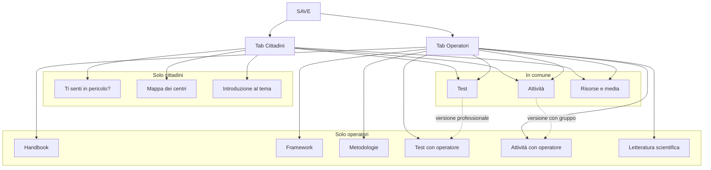

# Architettura del sito SAVE

Riferimento: lo schema "SAVE Repository". Due pubblici, cittadini e operatori, con una zona in comune (risorse e media, test, attività). Il sito è una pagina unica (`index.html`): gli indirizzi sono hash (`#vista` o `#vista/ancora`), le pagine intere si aprono in iframe dentro il pannello.

## 1. Gerarchia

```
SAVE (/)  · switch Cittadini | Operatori, uscita rapida sempre visibile
│
├── TAB CITTADINI
│   ├── Ti senti in pericolo?            #pericolo
│   ├── Mappa dei centri (CAV e enti)    #centri  (#centri/trova, /cosa-fa, /fonti)
│   ├── Introduzione al tema
│   │   ├── Forme e dinamiche            #forme
│   │   └── Segnali e cosa fare          #comunita
│   └── (zona in comune ↓)
│
├── TAB OPERATORI
│   ├── Handbook                         #handbook  → archivio.html?tipo=linee-guida,guide,formazione
│   ├── Framework                        #quadro    (Dal quadro all'azione)
│   ├── Metodologie                      #strumenti
│   ├── Test con operatore
│   │   ├── SARA-S, formulario           #sara
│   │   ├── SARA-S e recidiva            #rischio
│   │   └── Tool di risk assessment      #catalogo
│   ├── Attività con operatore           #attivita
│   ├── Letteratura scientifica          #fonti
│   └── (zona in comune ↓)
│
└── IN COMUNE (in tutte e due le tab, dopo le sezioni proprie)
    ├── Test                             #questionari (hub)
    │   ├── Capire la situazione         #orientamento
    │   ├── ISA 2023                     #isa
    │   └── SEA-12                       #sea
    ├── Attività                         #percorsi (hub)
    │   ├── Come stare accanto           #accanto
    │   ├── Cosa fare, caso per caso     #casi
    │   └── The Small Act                #gioco
    └── Risorse e media
        ├── App utili                    #app
        └── Archivio documenti           #archivio
```

Profondità massima: 2 clic dalla home a qualsiasi contenuto.

## 2. Mappa visiva



## 3. Mappa degli indirizzi

| Pagina | Indirizzo | Gruppo | Tab | Priorità |
|---|---|---|---|---|
| Home | `#` | — | entrambe | alta |
| Ti senti in pericolo? | `#pericolo` | Ti senti in pericolo? | cittadini | alta |
| Trova un centro | `#centri/trova` | Mappa dei centri | cittadini | alta |
| Forme e dinamiche | `#forme` | Introduzione al tema | cittadini | alta |
| Segnali e cosa fare | `#comunita` | Introduzione al tema | cittadini | media |
| Handbook | `#handbook` | Handbook | operatori | alta |
| Dal quadro all'azione | `#quadro` | Framework | operatori | media |
| Metodologie | `#strumenti` | Metodologie | operatori | media |
| SARA-S formulario | `#sara` | Test con operatore | operatori | alta |
| SARA-S e recidiva | `#rischio` | Test con operatore | operatori | media |
| Tool di risk assessment | `#catalogo` | Test con operatore | operatori | media |
| Attività da proporre | `#attivita` | Attività con operatore | operatori | alta |
| Studi e fonti | `#fonti` | Letteratura scientifica | operatori | media |
| Tutti i test | `#questionari` | Test | in comune | alta |
| Capire la situazione | `#orientamento` | Test | in comune | alta |
| ISA 2023 / SEA-12 | `#isa`, `#sea` | Test | in comune | media |
| Tutte le attività | `#percorsi` | Attività | in comune | media |
| Cinque storie / Caso per caso / Small Act | `#accanto`, `#casi`, `#gioco` | Attività | in comune | media |
| App utili | `#app` | Risorse e media | in comune | media |
| Archivio | `#archivio` | Risorse e media | in comune | media |

Vecchi indirizzi ancora validi: `#inizio` → home, `#test` → `#questionari`, `#app-utili` → `#app`, `#mappa` → `#quadro`.

## 4. Navigazione

- **Barra laterale (rail):** prima le sezioni proprie della tab, poi l'etichetta "In comune con gli operatori" / "In comune con i cittadini" e le tre sezioni condivise. Stessa lista, stesso ordine, nell'indice della home su telefono.
- **Switch Cittadini | Operatori:** cambiando tab a mano, se la sezione aperta non esiste nell'altra si torna alla home.
- **Link profondo o link interno verso una sezione dell'altra tab:** la tab cambia da sola e la sezione si apre (non si rimbalza alla home).
- **Colori delle barre:** vermiglio = strumento da usare, ocra = da leggere, bordeaux = solo operatori.
- **Sempre visibili:** uscita rapida (pulsante + Esc), 1522 e 112 nella home di entrambe le tab.

## 5. Collegamenti interni

| Da | A | Perché |
|---|---|---|
| Test (in comune), vista operatori | SARA-S | il ponte test → test con operatore dello schema |
| Attività (in comune), vista operatori | Attività da proporre | il ponte attività → attività con operatore/i |
| Test, vista cittadini | Trova un centro | dopo un test, il passo successivo |
| Segnali e cosa fare | Caso per caso, Cinque storie, Small Act | dalla lettura all'esercizio |
| Metodologie | Framework, Tool di risk assessment | dal metodo agli strumenti |
| Letteratura scientifica | PDF van der Put e Hilton, Handbook | dalle fonti ai documenti |

Nessuna vista orfana: ogni vista è nel rail della sua tab; quelle in comune sono in tutte e due.

## Da decidere

- **Handbook** è per ora l'archivio filtrato (linee guida, guide, formazione). Se ci sarà un vero handbook SAVE, prende il posto di `#handbook`.
- **Framework** e **Metodologie** hanno ancora pochi contenuti: vanno ampliati con i materiali del progetto.
- La mappa dei centri è solo nella tab cittadini, come nello schema; gli operatori la raggiungono comunque da link profondo (`#centri`), che riporta alla tab cittadini.
